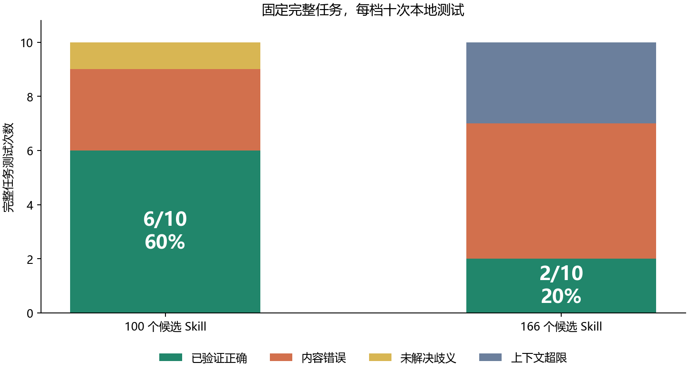

# Skill 做多实验与十次准确率报告

2026 年 11 月 11 日。依据老师补充要求，每个最终规模统计十次完整任务测试。本轮主测全部使用本机 Qwen3.5:9b。

## 已测结果

|候选 Skill 数 N|十次已验证正确|准确率|通过试次实际 Skill 种数 K|通过试次生成节点数|通过试次最长依赖链节点数|
|---|---|---|---|---|---|
|100|6/10|60%|2–5|2–5|2–4|
|166|2/10|20%|2–3|2–3|2|

**当前已经实际验证通过的最大候选库规模为 166 个 Skill，其十次正确率为 20%。** 已测规模下，100 档为 60%。更大的候选库以及其他模型、框架的通过情况仍待实测，通用数量上限尚未确定。十个 seed 衡量的是同一完整任务在固定配置下的表现，任务覆盖和样本量均有限。

N 表示一次暴露给规划器的真实候选 Skill 数。K 表示该试次实际产生产物的不同 Skill 数。节点统计实际产生业务产物的调用，链长度按真实上游引用依赖计算，根节点长度为 1。读取、审阅与提交三个控制工具另列。

100 档实际暴露 103 个工具，166 档实际暴露 169 个工具。模型从完整候选目录自主选择和组合，选中 Skill 后加载该份完整原始 SKILL.md。所有候选的名称、描述及原生函数 schema 同时进入规划器，全文加载发生在实际调用时。

逐 seed 的完整结果、K、节点和链长见《Skill十次准确率结果-20261111.md》。原始清单在 `tmp/skill-boundary-v2/ten-trial-status-20261111.json`，逐项绑定 summary、最终产物审查及 SHA256。

## 任务与正确性标准

选择任务一，持续扩大可调用 Skill 库。受控业务是为虚构开源项目 CourseDock 制作完整发布材料，包含功能与限制、新手上手、实际空 CSV 反馈模板、建议性的反馈流程及维护职责。本次验证范围为材料生成和跨 Skill 编排，CourseDock 的两个命令作为给定事实检查。

六项标准在测试前固定。

1. 功能、限制、版本和 MIT 许可准确。
2. 两条给定命令逐字准确。
3. 实际 CSV 只有 `issue_id,course,description,status` 四列表头，字段顺序正确。
4. 仓库链接、下载量、证言、收益和其他未知事实保持未知。
5. 反馈流转和维护职责可用，并明确标为建议。
6. 最终材料在上述事实之间一致。

原生工具调用、正式提交、产物落盘、依赖关系与六项内容要求共同决定通过。全部 17 个自动正例均阅读全文，并直接读取实际附件核对内容、行号和哈希。独立复核覆盖所有 20 次正式观测。

100 档包含 3 次明确内容失败及 1 次未解决的表述歧义，均未计入通过。歧义发生在 seed5，文档在建议段落中提出向用户告知“本项目不收集任何使用数据”，其含义可以指未来政策，也可以指当前产品保证。原审查与后续裁定均保留。166 档有 5 次内容失败、3 次上下文超限，均计入十次分母。

## 实现过程

### 真实 Skill 来源与扩充

注册表保存 166 个不同的真实来源、名称、原文路径与 SHA256。主要原始来源固定在 `sickn33/antigravity-awesome-skills` 的提交 `828257c3037dc7c3c3ec987decc5a603025a0ce5`，逐份来源链接保存在交付包的 SOURCE_ATTRIBUTION.json。

此前已有 163 份历史资格记录。本次尝试扩充六个来源，其中三个通过了各自固定资格用例的三个不同 seed 以及一次同 seed 重跑，各为 4/4，加入候选库后达到 166。新增内容涵盖代码解释、文档模板和需求编写。另外三个来源的失败记录完整保留。原 163 份的资格状态沿用历史证据，本轮直接核对了全部 166 份原文身份和实际输入。

### 自主规划与实际执行

规划器收到完整自然语言需求、完整 facts 和 N 个原生 Skill 接口。模型自己选择 Skill、输入任务及上游产物引用。

执行器读取选中 Skill 的完整原文，将原始 facts 和实际上游正文交给本地模型。生成正文原样保存为不可变 DOC/FILE 产物，记录生产节点、来源哈希、实际路径和引用关系。

后续 Skill 根据实际引用读取前序正文。系统从这些引用计算 DAG 的边、节点数与最长链。审查工具把真实检查结果返回规划器，模型可修订并再次提交。每次完整任务最多 16 轮。

### 事实约束与反馈改进

F 版在完整原 Skill 后添加通用事实来源约束，明确示例内容和原作者背景的适用范围。未知字段保留未知。模型视图使用稳定的逻辑产物 URI，实际磁盘产物及原始正文保持可核查。审查反馈实际进入下一轮规划请求。

冻结前的回归检查、语义审查已知样例校准及新增来源资格各有独立证据。最终的十次主测使用同一冻结 F 实现。这些实现改进存在实测记录，整体正确率提升幅度尚未由独立大样本对照确定。

## 固定运行配置与统计方法

- 本机 Ollama 0.33.1，Qwen3.5:9b Q4_K_M，模型 digest 为 `6488c96fa5faab64bb65cbd30d4289e20e6130ef535a93ef9a49f42eda893ea7`。
- RTX 5060 Laptop 8GB，24 GPU 层，单并发，32,768 token 上下文。
- 规划与执行关闭 thinking，temperature 0.2。事实证据审查采用已冻结的校准配置。
- 每个规模使用模型 seed1–10。先前正式 seed1–3 的原结果事前冻结，补测 seed4–10，每档新增七次，共新增十四次。
- 全部请求显式 `truncate=false`、`shift=false`，每个实际请求的 seed 和上下文均有核对。
- 14 次新增完整任务的来源、全文上游、产物和依赖审计通过，共 150 条新模型回复，记录的 prompt/completion 合计 2,428,924 tokens。
- 准确率按全部十次计算。已知 seed 功能复现、较高上下文对照、小档诊断和请求级复现另有原始记录。

新增十四次主测全部通过本机 loopback Ollama 执行。此次十次主测及补充复现使用的付费 API 调用数为 0。

## 失败位置与边界证据

166 档 seed1、4、6 分别在 33,582、33,241、32,849 token 的实际输入上收到 32,768 上下文超限错误。seed6 的失败请求保持相同正文与配置，又进行了两次新的请求级推理，均返回相同的 32,849 > 32,768 错误。

166 档第一个规划请求已使用约 28,781 prompt tokens，随后完整原源、上游正文和反馈继续增加上下文。已测数据呈现候选目录暴露开销与后续编排历史共同挤压上下文的现象。对应失败记录的 DAG 仅描述错误前已生成的节点。

此前 32k/40k 对照中，同一 33,582-token 请求在 40k 下可以继续，随后较长请求达到 41,226 tokens 后又超限。资源限制得到定位，完整业务是否正确仍由最终内容判断。

内容错误也出现在较小规模。常见错误包括把未知管理界面、服务地址或 Python 版本写成确定事实，以及把未提供的数据收集行为写成产品保证。100 档 seed10 在三份最终材料中补造“无固定公网地址”，实际空 CSV 与两条命令仍正确，该次按原事实标准判为失败。

探索阶段的 N5/10/40/60/80 各三次已核验正确率分别为 1/3、1/3、1/3、2/3、0/3，其中 N80 有一次歧义。这些小样本结果保留为诊断材料。更大候选数和更长依赖链都可能产生失败，当前数据尚不能把失败归因于单一 Skill 数量阈值。

## 可复现性与已验证范围

166 档 seed3 的完整业务已在新运行目录再次通过，便携包另有异目录解压后的真实完整任务验证。原源、完整任务、固定配置与实际产物均可追踪。两次正确产物的文字存在差异，当前证据支持功能复现。

根目录 `rerun_166.py` 提供这一已实测的 166/seed3 便携入口。`verify_bundle.py` 和 `rerun_166.py --verify-only` 提供离线文件、源身份、完整任务和校准检查。原始工作区的完整十 seed 重测命令保存在交付包 README 中。

历史原始 JSON 中的绝对路径按取证原貌保留，包内 `inputs/registry.json` 与 166 份原源使用可迁移的相对路径。Ollama 模型文件需在本机已有，服务实时 stderr 日志的绑定要求见包内 README。

## 提交表可用文本

### 规模、目标与正确性标准

我选择“Skill 做多”，构建了包含 166 个真实来源 Skill 的候选库。模型根据自然语言需求自行选择和组合，完成 CourseDock 完整发布材料任务。100 和 166 两档各进行十次固定 seed 测试，逐一检查实际最终文档、CSV、命令、未知事实和建议流程。最终已验证正确率分别为 60% 和 20%。候选库数、实际调用种数、生成节点和真实依赖链分开统计。166 档通过试次实际调用 2–3 种 Skill，生成 2–3 个节点，最长链为 2 个节点。

### 录屏演示与运行验证

演示 166 份真实来源注册表及原文哈希，展示一次 166 档正确完整任务的模型原生调用、真实上游引用、最终文档和空 CSV，然后打开两个规模各十次的结果清单。展示 166 档失败请求和两次同配置超限复现。再演示复现包离线核验及已保存的异目录真实功能重跑记录。每次结果均可追溯 summary、最终产物、内容审查和 SHA256。

### 失败位置、改进尝试与创新点

166 档十次中，三次发生 32k 上下文超限，五次存在最终内容事实错误。改进包括原 Skill 全文后的通用事实边界、稳定逻辑产物引用、真实正文依赖、基于原始证据的审查反馈和自动正例全文复核。最大已验证通过规模为 166，十次正确率 20%。未知产品事实仍会被补造，上下文开销仍随候选目录及执行历史增长，通用 Skill 上限仍待更多模型与任务实测。

## 录屏顺序

建议按来源注册表、完整任务及六标准、一次正确运行、十次统计、上下文失败及复现、实现与剩余问题的顺序同步口播。本人录屏、可访问的视频链接及课程表单提交仍需用户完成。

## 后续获授权的API补测

2026年11月11日新增一次DeepSeek完整任务测试，166候选、实际K2、2节点、链长2，最终原六标准核验通过。一次完整任务共10条API回复，204922 tokens。云端自动审查为legacy，与本地主测配置存在差异。详情见《Skill扩容DeepSeek单次测试-20261111.md》。以上本地十次主测的分母、准确率和原归档保留。

## DeepSeek十次统计更新

已按用户授权在此前一次正式云端结果上新增九次，166候选十次完整任务最终已验证正确9/10（90%），一次Web界面表述歧义未计通过。合计119条真实API回复、2455281tokens，全部最终文件及独立审查完成。最新逐次结果见《Skill扩容DeepSeek十次测试-20261111.md》。原本地两档十次统计及各自配置保留。
