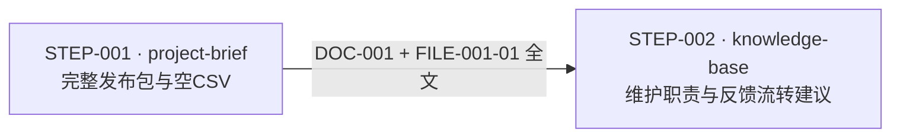

> 最新：F32/F40全部12主试次已结束并逐文复核，两个context的N100/N166均1/3正确。166/seed3同配置新目录真实重跑也完整正确，但正文和轨迹非逐字相同。可重复单次正确规模166，尚无3/3稳定档或理论上限。所有模型队列已exit0，联合复现包和最终交付审计仍待完成。

# 扩容重复验证结果与边界进度

本页对应新目标：确保本次扩充正确、可重复运行且可复现，再探索数量边界。仅使用本地Qwen3.5:9b，禁止付费API。

## 已完成的前置验证

新增6项各运行seed101/102/103三次，再以seed101同输入做一次真实新调用，共24次（18个不同seed试次、6个复现）。原文、用例、代码和配置预先冻结，不隐藏重试，不手改输出。全部24项已直接内容复核，原自动判定保留。47真实native回复：46正常stop，1长度失败。

|新增来源|不同seed正确数|同seed复现正确|正文哈希一致|本批资格|
|---|---:|---|---|---|
|code-documentation-code-explain|3/3|是|是|通过4/4|
|documentation-templates|3/3|是|是|通过4/4|
|requirements-writing|3/3|是|是|通过4/4|
|async-python-patterns|0/3|否|是|不通过|
|llm-prompt-optimizer|1/3|否|是|不通过|
|architecture-decision-records|2/3|是|是|不通过|

异步反例：tuple列表传入asyncio.wait实际报AttributeError；另一seed返回[2,6]而不传播ValueError；还有一次2300生成token预算耗尽。提示词漏{{notice}}。ADR把单个开发者的团队条件漂移成必须在开发者机器运行。错误复现仍是错误，不因哈希一致加分。

原自动11/24，实际内容16/24；自动误收2项否决，误拒7项用逐标准逐字证据纠正。所有原summary/verdict/正文均保留。代码解释0/5/4有标准库独立计算；异步错误有实际执行和产物哈希。内容复核由Codex主代理完成，不是教师或另一独立研究者验收。有限小用例和3个seed不能保证未来所有任务绝对稳定。

## 来源池与整体编排的区别

原169候选库保留，原163来源前缀不变；新增3项通过本批重复资格，因此下一轮工作池166项。原163仍是历史资格记录，未被本轮24次试验重新穷尽认证。不能把“166候选”说成“一次调用166种”或“全部166已证明稳定”。整体编排的正确率、实际K、节点与链长必须由后续主任务另测。

## 旧主实验C（已停止）

计划候选40/100/140/166各3次，32k、GPU24、legacy采样、非思考、固定候选顺序、配对seed=repeat、原16轮与全部验收门槛。主任务仍是原CourseDock完整发布材料包，原请求、六条标准和所有原facts键值均未变。

改进输入事实完整性：额外把未给定的默认端口、服务URL、管理界面、导出入口、安装命令、Python最低版本明确列为未知，并提供OSI官方MIT许可参考。没有给出业务正文、预设Skill选择或DAG，没有删要求或放宽通过标准。这是独立新输入组，不能与旧A/B拼接成功率，也不能把组间变化单独归因于数量。

旧B100自动2/3经逐文复核为0/3：补造界面/导出入口、MIT许可限制错误；140r1因用户暂停中断保留。新组中每次自动成功仍待直接内容复核。当前没有数量上限结论。

## 可复现交付

完整包：deliverables/skill-extension-repro-20261110.zip。包含原文、固定用例、24次原始请求/响应、逐项复核、独立执行证据、环境记录、源码、文件哈希与复现命令。复制到另一路径后已验证372个文件哈希、离线证据审计和CLI导入。没有为打包再次假装运行24次；实际同seed复现已经在原实验完成。

解压后先运行python verify_bundle.py，再运行python evidence/audit_provenance.py；需要重新本地推理时运行rerun.ps1。后者先核对Ollama版本和模型digest，创建全新运行目录，不覆盖旧记录。自动true仍需审查，不能复制旧响应充作新运行。

102项离线回归通过，测试替身不计业务成功。主任务边界附近的多轮结果、更大上下文完整业务对照及最终边界审计尚未完成，目标保持进行中。

最新主试次：C40r1原自动通过，实际K3/节点4/链4，但最终DOC004补造“无外部数据泄露风险”保证，直接复核否决。来源重复资格不等于整体业务稳定；该语义失败不证明40是数量上限。其余预注册试次继续运行，不能据未完成组给出最终成功率。

## 验收修正与新D组

旧C40r1把本地留存推成零泄露风险保证；r2五个实际CSV附件有8处4列表头配5空字段的记录；r3耗尽16轮。0/3不能解释成40为数量上限。N100r1在主动停止时留作未完成，不计通过；原计划12次只结束3次。

校准A在5个已知案例中匹配2/5，四次本地思考/结构化审阅仍漏检UI、MIT限制和零风险，不能启用。校准B增加版本化程序约束后为5/5：4个已知错误由规则拒绝，仅1个正确例实际调用模型。不能说模型语义准确率5/5或独立泛化验证通过。A/B正确例请求和判定完全相同、native时间不同，确认是实际新调用。完整gold标签未给模型；原错误与旧分数保留。

fact-evidence配置使用完整原文行号、六个固定证据槽、实际附件读取；所有CSV字段记录按表头校验，空物理行单列；已观察到的无依据UI/URL、MIT禁令和零泄露保证被定位到真实引用/行号并反馈，模型需在原16轮自行修订，host不改正文。规则仅覆盖已观察的具体错误，不能取代最终逐文复核。

115项离线回归通过。运行入口要求5个已知案例全匹配且关键实现哈希与校准版本一致，才允许新profile；传输失败不算正确拒绝。新D从10建立较低规模基线，再40/100/140/166各3；原C的请求、全部facts和六标准与D一致，规划/工人仍legacy非思考，审阅配置改变并单列，绝不拼接成功率。

## D失败诊断与新版校准

D10r1实际K4、业务节点7、最长链3；review003输入7655 token，未接近32k上下文，think=true耗尽6296生成token且final content为空，导致整轮失败。这是审阅阶段生成失败，不是10个Skill的数量边界。该候选DOC001仍把命令指定4177称作默认端口，DOC002则写默认未知，也不满足正确性。

主动停止该批后，完成1/15、通过0，n010/r2保留为未完成，40/100/140/166均未执行。原始响应与诊断留存。新版非思考审阅避免上述只思考不判定；既有默认端口检查增加Markdown格式支持，业务正文不改。115项离线回归通过；六例定向校准进行中（原5例＋D失败候选），全部通过并哈希锁定后才新建10档三次业务基线。尚未测得当前可靠上限。

## 当前实现与复现入口（E版本）

输入自然语言需求→规划器同时看到N个来源名称、原始描述与统一调用接口→自主选Skill与已有产物引用→执行器装入所选完整SKILL.md、完整原facts及被选中的完整上游正文→本地模型生成实际文件→引用库登记新DOC/FILE及生产节点→独立审阅→在原16轮内自主修订或正式提交。所有输出原文留存；宿主不替换业务答案。

候选N、实际产出种类K、真实业务节点和最长依赖链分列；read/review/submit三个控制工具不计N或业务节点。重复调用同一Skill增加节点但不增加K。曾生成而最终未提交的草稿也有节点，所以节点数不能直接等于正确有效步骤数。来源名和规范化哈希去重166项均已重新核对，但同源文字不同不保证语义完全不重叠。

E：32k、GPU24、Qwen3.5:9b、Ollama0.33.1，规划/工人legacy非思考；证据审阅非思考＋推荐采样（temperature0.7、presence1.5）、2200生成token。截断与上下文滑动均false。固定候选顺序，seed=repeat（1/2/3），原请求/事实/六标准/16轮不变。每个尺度先三次并逐文复核，才决定更大尺度。源资格24次与校准6例均不计主业务成功。

本次入口（新复现必须更换prefix，目录不得覆盖）：

```powershell
python experiments/skill_boundary/boundary_scan.py --prefix boundary-repeatqualified-166-e32-n10 --registry tmp/skill-boundary-v2/local-qualification/repeat-qualified-166/registry.json --source repeat-qualified-source-c --sizes 10 --repeats 3 --release-fact-guard --candidate-order frozen --paired-seeds --semantic-review-profile fact-evidence --semantic-calibration tmp/skill-boundary-v2/semantic-calibration/semantic-evidence-c
```

运行前会校验来源原文、已有源资格和六个已校准实现文件哈希；任何失败保留。三次不是总体可靠性证明，3/3也只能报告“本固定任务、当前配置的三次观测通过”。只有实际边界前后重复数据才能给条件性边界；目前不把166候选库或历史被撤销分数当上限。

E10r1最终失败：实际12节点、K5、最长链7，6次正文读取和反复修订后，planner15输入33,906token超过32,768，接口HTTP400明确拒绝，truncate/shift均false。未获通过审阅或正式提交，不能计通过或推断“10就是Skill上限”。r2/r3为独立seed新请求，不复用该轮正文。

## E10最终结果与40档恢复

|seed|自动|逐文复核后|K|节点|最长链|失败原因|
|---|---|---|---:|---:|---:|---|
|1|失败|失败|5|12|7|33906输入token超过32768，未提交|
|2|通过|否决|4|5|2|把web_management_ui未知写成没有，终稿内部矛盾|
|3|通过|否决|5|6|2|DOC001:L66及DOC005:L72以本地留存推断“无需额外隐私协议”，未有输入事实支持|

第三轮否决是在检查任务事实依据，并未判断法律实际上要求什么。两份原自动通过的全部最终正文均已读取；逐行否决与正文hash保留，原summary未改写。E10正确0/3，不能据自动2/3宣称稳定。证据审计通过23节点、14附件、54真实响应，0重放；证据完整不等于业务正确。

40档原组e32-n40三次在推理前收到local URLError，模型响应0，均计故障失败而非通过；不能用于推断数量边界。恢复本地服务、重新核对Ollama0.33.1和相同模型digest后，新建e32-n40b独立组三次。原故障分母与新组分开列出，不覆盖或删除失败。其他输入、顺序、配对seed、32k、GPU24、16轮及全部要求保持E配置。目录扩容可能加入更合适能力，表现并非必然单调，所以继续测40；实际正确率仍逐档复核后报告。

## 复现包与连续扩容（最新）

E10复现包：deliverables/skill-boundary-e-repro-20261110.zip，2,762,910字节，SHA256：633ad4fb15f60d20c8c138930365ba992c9398d7b63228884e37f5a22bfdd0d7。另一路径验证795文件哈希、冻结校准、来源原文与重跑入口导入通过；ZIP内部795文件全部hash一致、testzip通过。这是E10已结束阶段的证据包，不含后续高档结果。

服务恢复时发现Shell追加日志被转码UTF16，40b/c在途停止保留，不计通过；改为Python子进程直接二进制追加原生UTF8日志，保留原日志全部字节，并清理两个此次重启遗留的模型子进程。实际本地预检输出ready=true，22输入/6生成token，日志新字节UTF8可解码且无NUL；该健康预检不计Skill试次。版本、模型digest、GPU24/32k与禁云配置保持不变。

当前独立系列：boundary-repeatqualified-166-e32-expanded，40/100/140/166各3次，共12计划，固定候选顺序、配对seed1/2/3、原需求与16轮。各档实际结果单列，未完成和自动通过待复核都不能作为已知上限。原服务故障组三次失败和40b/c中断记录仍保留。

## 扩容E32在途复核

40三次全部失败：r1规划16轮耗尽（K3/6节点/链6）；r2输入33477token超过32768（K6/9节点/链6）；r3规划预算耗尽（K4/10节点/链10）。100r1输入33462token超过32768（K4/6节点/链4），100r2自动通过（K3/3节点/链2）但最终DOC001:L74、DOC002:L73、DOC003:L23把Skill作者WHOISABHISHEKADHIKARI指认为CourseDock项目所有者。其来源可定位到project-brief完整SKILL.md第7/10行元数据，业务facts没有项目所有者身份；建议标签不能支持该身份断言，直接复核否决。100当前实际0/2，r3在途，未提前计算完整三次成功率。

已结束前四项证据审计通过31节点/24附件/88真实响应/0重放。失败涉及反复CSV修订、终稿引用遗失命令、未给定断言及读取历史占用上下文，不能直接归因于候选N。已预先准备独立40k上下文六例校准入口run-calibration-context40.py；当前32k全部结束后再串行做完整N100三次40k对照，不把单请求诊断当业务通过。源元数据身份污染另作为明确改进点，当前运行不热改。

## 已确认100候选单次成功

E32扩容n100/seed3正式提交并通过隔离终验，逐文检查完整两份文档及两份实际CSV，六项原标准全满足；终稿hash与直接检查版本一致。具体维护者姓名/账号保持未知；没有把Skill元数据作者当业务负责人。实际CSV均只含有序四字段表头。project-brief输出完整发布包，knowledge-base读取实际DOC001/FILE001并生成维护方案，真实依赖STEP001→STEP002；两种Skill、两个业务节点、最长依赖2。planner初始实际暴露103工具，其中100业务Skill＋3控制，不是实际调用100种Skill。

因此100同档三次：原自动2/3，逐文复核正确1/3（约33.3%）；40档0/3。最大的本版本“已验证单次成功候选数”目前100，“三次全过规模”仍没有；不将此当稳定上限或普遍模型上限。较大目录可能改善选择，现有结果也不能假设表现随N单调下降。

成功证据：deliverables/skill-boundary-100-pass-evidence-20261110.zip，661450bytes，SHA25675973153c096b64ffd5a2e89fa969a48ded21a1bf6412245ce54df91bc7d9fca。169文件ZIP内部hash/testzip均已验证；含100来源原文、实际成功试次、逐文六条证据、完整请求响应和终稿hash。重跑环境沿用已验证E10复现包，命令rerun_local.py --sizes 100，保持三个seed并建立新目录，不能只复用本次成功正文。

40/100六个已结束试次完整证据审计通过36节点/29附件/106真实响应/0重放。当前19289仍live，继续140和166各三次。后续需同配置成功seed真实新运行复现及独立40k完整业务对照，不能以一次成功宣告稳定性目标完成。

## 140档追加与复现预注册

140r1：K3/3节点/链3，1次审阅及3次正文读取后，输入34837token超过32768，接口明确拒绝。140r2：K3/3节点/链2，自动通过，但最终三文档各出现无依据项目所有者WHOISABHISHEKADHIKARI、以及“服务URL及Web管理界面在当前版本中不可用”，共6处明确定位；原facts两项均null未知，原作者只存在于Skill元数据。终稿hash与父复核候选完全相同，内容否决，当前140实际0/2。该错误在100/140复现，不能当候选数量本身造成的边界。

已结束八项完整证据审计通过42节点/34附件/125真实响应/0重放；仅100r3已获直接正确性通过。140r3及166仍由同一19289执行，不另开并行推理。

复现与对照的预注册文件：tmp/skill-boundary-v2/followup-preregistration.json；冻结原全部facts/用例/来源目录和所有运行py文件hash，现已检查一致。基线全结束后，先重新执行N100原seed1/2/3整轮三次（失败seed也保留，非只挑成功seed3）；再进行六例40k校准与N100/40k三次完整业务。后三次仅变context为40960，其他条件不变，32k/40k成功率单列。原三个seed的再执行不称新独立随机样本。新输出目录导致下游引用路径不同，会逐请求比较真实hash和仅路径差异，不假称所有模型输入字节一致。入口run-e-followups.ps1禁止在基线未结束时启动，并检查冻结hash，不隐藏重试或覆盖目录。

## 140档最终复核与初始上下文实测

140r3最终自动通过（K2/4节点/链3），但DOC003:L75-L76及DOC004:L167-L168重复“serve仅本地访问、不建立外部网络连接”的当前行为断言。原事实仅给材料本机留存及--port命令，未提供监听范围或外部连接行为，不能据此保证这些属性。四处真实行号与终稿hash匹配后否决，140最终正确0/3、原自动2/3均保留。166r1已真实暴露169工具并正常生成；此为166业务+3控制，尚非整轮通过。

|候选N|实际工具含3控制|初始输入token|32k剩余token|
|---:|---:|---:|---:|
|10|13|3498|29270|
|40|43|8339|24429|
|100|103|18013|14755|
|140|143|24465|8303|
|166|169|28781|3987|

这些是各档seed1首轮native实际prompt_eval_count，不是估计或业务通过率；source_request可溯源initial-exposure-measurements.json。目录变大后留给执行/修订/审阅历史的上下文减少，但仍需完整业务对照，不能从首轮空间直接推演通用Skill上限。

未启动的40k对照现扩为100与166各三次，共6个完整新试次；保留原预注册原文，新增followup-amendment-include166.json记录原文件hash、改动理由与时间。新前缀e40-expanded，代替从未运行的e40-n100-only计划。32kN100三个原seed整轮复现和六例40k校准保持不变。冻结原facts/目录/全部运行代码及变更原始预注册hash已实查，仍由run-e-followups.ps1等待当前队列结束后串行执行。

九个已结束32k试次完整证据审计通过46节点/37附件/137真实响应/0重放；只有100r3已确认正确。

## 166首轮复核

166r1原自动通过，实际选择project-brief、developer-onboarding、csv-manual-export、knowledge-base、faq-generator共5种，5节点，最长链2；FAQ节点实际读取STEP001/002原文，并非空调用。全部最终5文档和CSV文本直接阅读后否决：DOC001:L35/L36把未知的Web管理及导出界面写成没有，并提出未给定CLI/API导出交互；DOC005:L7/L14继续沿用该断言。原facts对应两字段均null，不能推出界面不存在。

因此166当前实际0/1，不能据自动通过宣传166正确或稳定。也不能反过来声称API不支持166：首轮真实169工具正常调用并完成正式提交，协议层能执行，失败来自业务事实。候选数、协议执行成功、内容正确三者需分别看。

十个已结束试次证据审计通过51节点/38附件/149真实响应/0重放；整体当前只有100r3获逐文正确性通过。所有原自动分数保留，另两次166继续运行。

## 计数口径与已确认成功DAG

N为同时暴露的可调用业务Skill候选数；K为本次实际产出过文件的不同Skill种类。节点为实际产物生产调用，重复同种Skill只增加节点、不增加K。失败轮中的节点可能包含未通过内容验收的草稿，不称为正确有效步骤。read/review/submit三个控制工具均不计业务Skill或业务节点。最长链按节点数计算，根深度为1；链2表示两个节点、一条依赖边。

100/seed3已确认成功的实际依赖图（由dag.json与输入引用核对）：



该次N100、K2、2节点、链2（1边），所有下游输入为实际产物全文，非预写DAG或空调用凑依赖。节点数不能写成100；仅候选空间达到100。

166r2已结束失败：实际K2/2节点/链2，1次正文读取后请求33103token超过32768，未获正式提交；当前166正确0/2，最后seed3仍在途。

## 32k组最终结果与后续真实运行

|候选N|原自动通过|逐文复核正确|实际K范围|节点范围（含草稿）|链节点数范围|
|---:|---:|---:|---:|---:|---:|
|40|0/3|0/3|3–6|6–10|6–10|
|100|2/3|1/3|2–4|2–6|2–4|
|140|2/3|0/3|2–3|3–4|2–3|
|166|2/3|0/3|2–5|2–5|2|

166r3正式自动通过（product-design-harness→copy-editing，2节点/2种/链2），但最终DOC002:L32写出未提供的pip install coursedock，L93把null Web管理界面改成“无Web界面”，L94把null导出入口改成“仅支持CLI”；直接复核否决。完整12试次的所有六个自动正例均读完最终正文并保留逐行依据，只有100r3正确。未把失败、同seed复现或后续不同context分数混入该组。

完整证据审计通过55节点、42附件、166真实模型响应、0重放。该响应数恰好166，与候选数是不同概念，不能互换。已验证单次成功候选规模最大100；没有三次全过的规模，不能宣称100为稳定或通用硬上限。

完整32k复现包：deliverables/skill-boundary-e32-full-repro-20261110.zip，4946171bytes，SHA256d661fc9e52456875bc96d04947412efa201e58a2ec4d2ecaf3b2b9c71569cab2。ZIP内1535文件哈希/testzip通过，复制另一目录后verify_bundle及rerun_local --verify-only通过；不把这些文件检查冒称重新推理。包内完整四档重跑入口保留所有标准和三个seed；自动true仍需直接复核。

原19289已明确exit0；随后run-e-followups.ps1已通过冻结代码/用例/来源hash检查并真实启动，当前唯一推理handle6160。先是e32-n100-repro原三个seed完整新执行，再六例40k校准与e40-expanded的100/166各三次完整新业务。当前32k复现第一轮在途，不能提前声称已复现成功或40k改善。

## 32k整轮复现首项与路径变量

新N100/seed1已真实结束失败，33430token超过32768（K5/5节点/链5）；原N100/seed1为33462token上下文失败（K4/6节点/链4）。原失败分母不改，复现组该次单列失败。

逐请求核对：planner00请求字节完全相同（SHA c8a033436dcde4c407073544683207937d88f431b00a21c540d9f3ab80d23117），内容和调用规范化后也完全相同；raw native message的唯一差异是服务生成的tool_call随机ID，不能误当模型推理改变。第一个worker请求与正文均逐字相同，native时间不同，证明确有新调用。第二个planner请求的差异仅来自新输出目录路径（只在分析副本替换路径后相同，真实请求未改写），该次规范化输出开始不同。因此共同失败类型复现，但全执行轨迹没有逐字复现。路径是已观察到的额外输入变量，不能仅凭固定seed宣称全输入相同，也不能把后续context组差异全部单因归于context。源码哈希保持冻结，此发现未热改在途运行。逐项比较见复现trial的reproduction-comparison.json。


## E40完整业务与F下一组（2026-11-10追加）

E40的100/166各3次正常结束，唯一串行6160已exit0。68条新模型响应、20个实际产物节点、16个附件经原E物理/来源审计通过；这不是语义正确证明。所有6个原自动正例现已直接阅读全文和实际CSV：N100仅seed3正确（K3、节点3、最长依赖链2节点）；N166三个均错误。有效结果100为1/3，166为0/3；与E32、相同seed复现组分别报告，不拼分母。

N100/seed1的未知Web界面/导出入口被说成无UI/CLI；seed2把Skill作者WHOISABHISHEKADHIKARI当成项目Owner。N166/seed1仍补造UI/导出入口及无专职团队；seed2把本机留存推成“无外部服务依赖”；seed3同时补造pip install coursedock、无Web界面及仅CLI。逐字行证据、完整最终文档hash和实际CSV解析写入各trial的content-review-20261110.json，effective-status-20261110.json单列有效分数。原自动summary/series不改，因此不能把原series中的fully_passed当最终内容正确率。

当前已知是：候选库166可以全部展示并执行动态选择；最大逐文验证的单次成功规模100。没有任何当前主业务规模达到三个seed全部正确，稳定边界尚未确定。166不是已证实的正确上限，100也不是理论上限；语义错误与32k上下文溢出必须分开。

F是独立协议组，保留全部原需求、facts、六标准、源SKILL全文、166候选、候选顺序、16轮和严格验收。仅消除模型可见的实际run目录扰动（包括真实错误反馈），并在源全文后明确Skill作者不是项目Owner、null保持未知。主机不修业务答案、不固定Skill或DAG。两项输入改动一起测试，不能宣称单因素因果。原E仍冻结。

F五项新增回归原E全部失败，F整套120项离线测试通过，涵盖实际控制器消息、跨目录等价视图、真实附件读取/篡改拒绝、完整源与facts、无输出修补。离线替身不计业务成功。先核对预注册全部F源码hash，再启动62447串行F32独立校准→N100/166各三次→审计→F40独立校准→同两档各三次→审计。所有自动正例继续逐文复核。F真实结果尚未完成，目标继续进行。


E40与同seed复现的新独立交付：deliverables/skill-boundary-e40-followup-repro-20261110.zip，3990108字节，SHA256 e244e590fc77446cc83f65a49a43bdac77a45bcb2865d1efd4949fbc3aa095b0。1215清单文件在ZIP内逐项校验，并实际解压至另一目录e40-followup-relocation-check，verify_bundle和rerun_local --verify-only都通过，不产生新模型调用。默认真实重跑为原完整100/166各三次、40960上下文，本地版本/digest预检；旧E32主包原字节保留。历史请求绝对路径完整保留供追溯，不能承诺E跨目录逐字复现。

F32真实校准已6/6标签匹配，其中5个规则拒绝+1个本地模型接受；没有将其称为6次模型正确判断或业务成功。当前62447已进入F32 N100/seed1原完整业务，32k/24GPU、全部原候选与标准，最终正确率尚未产生。


F32首个N100/seed1已完成：原自动true，K3/节点3/最长链3节点，12条全新模型回复。实际来源/完整上游/实际规划回执/读取/审阅反馈传输经F partial audit通过；模型实际收到artifact逻辑路径，原物理文件仍可读、完整原source与facts保留。全文直接复核仍否决：DOC001和DOC002 L18均把“不支持PDF OCR”扩大为“无法直接处理PDF文件或进行光学字符识别”，前半是额外未给定的产品限制。L56搜索接口措辞有歧义，不用于该否决。两个文档逐个匹配实际文件，正文hash相同；第三文档和实际CSV均仅正确表头。F指令改进未消除所有事实漂移。当前仅完成1/3，N100不能报完整阶段0/3或稳定性改善，原自动记录不改；62447继续其余预注册试次。


F32 N100/seed2完整结束，原自动通过且最终全文直接复核通过：实际K3、节点4、最长链4节点；其中一个是被替换的错误草稿，不能把四节点称四个独立正确步骤。初次review指出DOC001 L40默认端口4177无依据，模型在原16轮内调用project-brief生成DOC004，最终manifest排除旧DOC001，DOC004 L41基于default_port:null说明未指定默认值。两次可见review、一次无效提交拒绝均保留；没有隐藏重试或主机修补。三份最终文档及两份实际CSV已逐项读取/hash和字段核验，六标准的真实行证据写入content-review-20261110.json。文档中“未定义（default_port为null）”在此facts上下文解释为输入未指定，不作“软件确定没有默认值”的断言；该解释已明确记入复核记录。

当前F32 N100完成2/3，自动2次true、内容正确1次；不能用部分观测声称整个档1/3或稳定改善。两个完成试次的真实F审计共7节点、3附件、28新模型回复、0重放通过，原文/完整上游/实际路径视图/审阅消息均相符。62447继续N100/seed3及后续166/40k，原预注册不变。

新增《Skill编排实现与汇报说明-20261110.md》集中给出真实实现、已完成E矩阵、N/K/节点/链口径、来源限制、失败例、复现命令与本人录屏展示顺序；F复制来的早期README/协议统一标明历史配置，防止误用旧六任务族、两个控制工具或全文曝光描述。F全部冻结Python源码hash仍通过检查，当前模型实验不受文档整理影响。


F32 N100三次已全部结束，自动3/3、内容复核1/3，仅seed2正确。seed3最终DOC002 L73把无云同步推成全部维护必须本地，L106把建议未来审查日期填为Last Reviewed，L108又填Published。具体2025-06-01来自planner生成的子请求，原facts与原knowledge-base源文均没有该日期，不能误称为源模板逐字污染；已经保存原请求hash、源hash及逐字链路。工人接到了原facts但仍将规划器自增数据当成项目事实。

E32/F32 N100配对比较证实三个seed各自首个planner请求字节完全相同，首个规范化assistant正文/真实函数名参数也相同（忽略服务端随机调用ID）。首个worker请求只变更system末尾追加通用来源边界，完整原system为前缀，原facts/子任务/其他参数均相同；后续还叠加逻辑路径和生成历史变化。E32正确向量[false,false,true]，F32[false,true,false]，都为1/3，不能宣称总体稳定性提高或将变化仅归因于路径。比较写入comparison-e32-f32-n100.json。

完成三试次的F来源/物理/实际消息审计：9节点、5附件、37全新模型响应、0重放。实时loopback只读核对Ollama0.33.1及Qwen模型digest仍与F预注册相同，当前模型上下文32768；环境观测另存。62447已进入166/seed1，F32/40仍未完成。


F32 N166/seed1已明确终止失败：首请求166候选+3控制工具正常接受，prompt28781；后续planner02完整请求33582>32768被HTTP400拒绝，truncate/shift均false，无静默裁剪或重试。已生成K4/4节点，但全为并行根节点，链长1、依赖边0，未满足组合标准。failure-diagnosis.json保存错误与请求hash。该失败不证明166是内在路由上限，也不把四个节点写成正确执行链。F32当前N100已完成1/3正确，N166仅完成1/3且失败，剩余两次未计通过。43条新响应、13节点、6附件的完成试次partial audit通过；62447继续seed2，然后完成剩余32k与独立40k。


F32 N166/seed2已完成：原自动true，K2/2节点/链2；最终两文档和两CSV全部实际读取/hash复核后否决。DOC001 L23断言“无外部服务连接”，L91将web_management_ui:null解释为“确认仅通过CLI运行”。额外metadata CSV是知识库注册表，和反馈空模板字段不同；已完整解析，不把它的非空行误判为虚构反馈记录。仅两条确定的未支持产品断言即可否决。当前N166已完成2/3，两次均未正确通过（一次上下文失败、一次内容失败），第三次仍在运行，不提前写整档0/3。完成试次的F审计现为15节点、8附件、53条新响应、0重放；原自动分数完整保留。


F32两档6次全部结束，所有5个自动正例均完成全文/附件直接复核。N100自动3/3、实际1/3；N166自动2/3、实际1/3（seed3正确）。N166/seed3实际使用product-design-harness→copy-editing，完整DOC001被读取并生成真实优化版DOC002；K2、节点2、最长链2节点。最终仅交付DOC002与FILE002，85行文档及实际CSV读入/hash均匹配；六条原标准的逐字行证据已写入content-review-20261110.json。未知保持未知，流程/职责明确建议，未发现无依据UI/CLI-only、安装、负责人或网络保证。

最大已验证单次成功候选规模更新为166；当前仍无任何完成档达到3/3正确，稳定上限未建立。不得把166说成单次调用166种，或把F32这一正例说成重复可复现已证明。原F32全部17节点、10附件、63条全新响应、0重放最终审计通过，原自动结果仍保留。

F40独立校准六标签全部匹配（5规则拒绝+1模型接受），进入100/166各三次完整业务，仍由62447串行运行。新增已知seed复现计划及预注册：固定原F32 N166/seed3、相同32768/24GPU/全部166来源/原完整用例和16轮，等62447终止后在新目录一次真实重跑。单试次索引1但模型seed必须3，不计新独立seed，不重试直到成功。临时入口离线防错门槛已6项红→绿；尚未运行该复现。


F40 N100/seed1完整结束原自动true，但全文直接复核否决：仍把不支持PDF OCR扩大为不能处理PDF文件。实际全部最终文档/CSV哈希和F32同seed相同，正文再次实际读取，不是复制旧模型回复。12个模型请求的名称集合完全相同，逐项JSON比较确认唯一差异是options.num_ctx（32768→40960）；物理run目录已不进入这些模型payload。这是此次F路径规范化的可检查输入控制证据，不说明内容正确或普遍确定性。比较写入comparison-f32-f40-n100-s1.json。当前F40仅完成一个试次，不提前报整档正确率。

原最大单次成功166/seed3的独立复现入口已固定：7项离线防错测试通过（包含真实调用边界seed3、错误context、源码hash漂移、前置队列未结束、缺完整audit拒绝启动，以及无网络verify-only），与业务分数无关。预注册及入口/test字节已冻结；尚未开始新推理，等待当前62447全部结束。


F40 N100/seed2完整结束并通过内容复核：K3/节点4/最长链4节点，保留原预算内的默认端口修订。新最终文档及两实际CSV全部重新读取并校验hash，完整原任务/facts/六标准与已接受的F32同seed完全一致；六条真实行证据逐项重新核对。F32/F40该seed的16个真实请求逐项仅num_ctx不同，所有最终正文hash相同，且16条新native响应created_at均不同于旧响应，未重放。该正确功能结果在40k重现，不和32k合并独立样本数，也不代替同配置166复现。当前F40完成2/6，N100本档仅结束2/3、一败一过，剩余仍在途。完成部分7节点、3附件、28新回复、0重放物理/来源审计通过。


F40 N100三次全部结束，原自动3/3、内容正确1/3，仅seed2正确；第三次仍保留本地维护绝对限制、Last Reviewed日期和Published状态三项无依据内容，已逐项核对当前真实行与实际文件。三个seed的全部12/16/9共37个模型请求，在F32/F40之间逐项仅num_ctx不同，最终正文hash及正确向量[false,true,false]均相同；这个受控对照没有显示100档正确率因32k→40k改善，不外推总体概率。37条真实新回复、9节点、5附件、0重放完成部分审计通过。F40 N166三次仍在运行，不能报整档；最大单次已验证166来自已结束F32/seed3，稳定上限和同配置166复现仍待后续。


2026-11-11追加：F40 N166/seed1已终止失败，8实际节点/K4/最长链4节点；先前32k拒绝的planner02完整请求33582 tokens在40k被真实接受，两个请求只差num_ctx，实际native prompt_eval_count33582且正常stop。随后review02仍指出DOC005 L44/DOC006 L46把指定端口写成默认端口，未修完；planner09完整请求41226>40960再遭明确拒绝。failure-diagnosis.json保存两类失败与实际请求hash，不能把走得更远称通过。

F40 N166/seed2已完整结束原自动true，当前全正文及实际反馈CSV/元数据CSV均读取/hash后仍否决：DOC001 L23无外部服务连接、L91把未知UI写成CLI-only。10个真实模型请求与F32同seed逐项只差num_ctx，所有最终正文hash相同，native timestamps均不同；这是全新调用而非重放。目前F40仅N166最后seed未结束，不能报整档0/3。完成部分19节点/10附件/64新回复/0重放审计通过。

F32六次独立证据包已生成deliverables/skill-boundary-f32-evidence-20261111.zip，2764914字节，SHA256 9fff87f63c01abcad15b9d60786fd8d6b083ed572f98e4967a731d93b58fec80；ZIP CRC、773个清单文件、全部166源SHA均已实查，并解压到另一个目录运行verify_bundle，全部通过且零模型调用。包含原全部6次成功/失败、实际源、校准、逐文复核及原始代码，历史路径保留；它是取证包，不声称新模型重跑或跨机器便携执行已完成。F40与已预注册166同seed复现不在此包最终结果范围，目标继续。


2026-11-11最终模型阶段：62447已exit0，F32/F40各100/166三次共12个完整主试次全部结束，10个自动正例全部经完整内容复核。两个context的N100/N166均为1/3正确；F40最后166/seed3也完整正确，85行文档与实际空CSV哈希和F32相同，10个请求仅num_ctx不同。F32最终审计17节点/10附件/63新回复；F40最终审计21节点/12附件/74新回复，均0重放。没有证明增加context改善这批正确率，也没有3/3稳定档。

预注册已知166/seed3新目录重跑已真正结束，唯一handle39382也exit0。单试次索引1、所有实际请求均模型seed3、context32768；原完整166候选/六标准/16轮/原实现未变。原自动true，新89行DOC002与实际空CSV经完整直接复核均正确，K2/节点2/链2，functional_reproduction_accepted=true；记录见content-review-20261111.json与effective-status-20261111.json。它不新增独立seed，不改原三seed的1/3。已知可重复的单次正确候选规模166，仍不能称166稳定上限或全166能力认证。

逐字轨迹未复现：初始planner请求字节相同且规范化首个函数/参数相同；首个worker请求SHA均6660ced1d4dfe59fc0b4cf431789c3ffde45d83753a42ed4eb63dd4d39b36c06，但模型正文先出现差异，后续输入随生成历史变化。原85行终稿SHA5d990f...，新89行SHAa580ec...；两稿都满足原任务。不能把该差异归因于随机tool-call ID或run目录；GPU/CPU数值、KV缓存或其他运行时状态尚未隔离，具体原因未证明。reproduction-content-diagnosis.json保存首个实际正文差异证据。

该重跑来源/真实上游/实际消息/文件/seed/终验审计通过：2节点、2附件、10全新模型回复、0重放。当前F两context与该重跑共147个新回复，统计仅作取证总量，不把各context或已知seed合并稳定率。全部模型推理已结束；剩余工作为联合复现包、可用新prefix入口、异目录核验与逐要求最终审计，目标暂不宣布完成。
