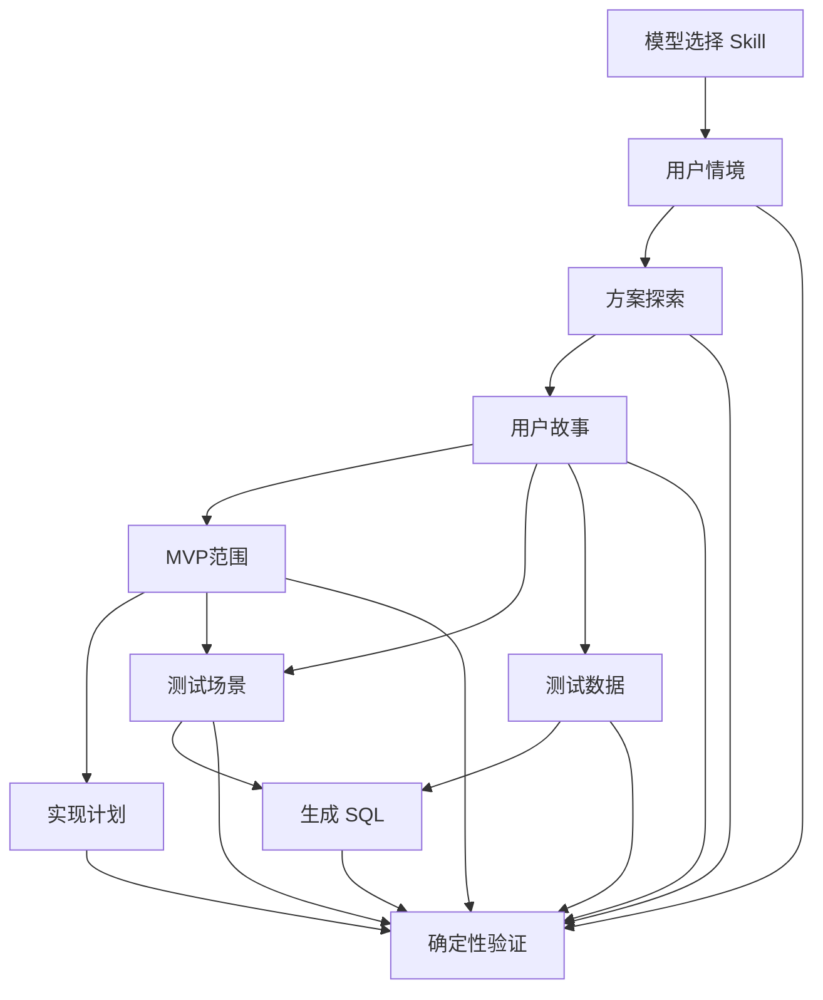

# SkillFabri 多 Skill 试接入记录

> **后续审计纠正：本试验预先规定角色、任务、输出模板及DAG，主要验证提示词适配与固定流程，不能作为自主Skill编排上限结论。** 见 [实验口径审计](skillfabri-实验口径审计-20261108.md)。

日期：2026-11-08（北京时间）。本轮是用户要求的初步接入试验，不是正式产品验收。

## 做了什么

从老师提供的 [SkillFabri](https://skillfabri.com) 读取公开目录，沿条目链接用 skill-installer 下载原作者的 Skill 包。记录来源 URL、固定提交及 SKILL.md 的 SHA-256，没有执行包里的第三方脚本。公开目录快照有 14,460 个条目，但本轮可供编排的只有实际下载的 **8 个**，不把目录总数计入接入规模。

暂用“校园竞赛报名管家”作为试验题材：学生面对多份竞赛通知，希望得到日期待办、缺失信息提示与近期截止清单。它对应真实使用场景；本次全部输入为六条明确标注的虚构通知，没有证明用户需求或产品价值已通过访谈验证。

本轮输出是该产品的场景、方案、用户故事、MVP范围、实现计划、测试场景、样例数据，以及实际执行过的筛选 SQL。尚未实现竞赛管家的界面或通知采集功能。

## 实际接入与调用的 8 个 Skill

| Skill | 本轮用途 |
|---|---|
| job-stories | 情境、动机、期望结果 |
| brainstorming | 比较方案并列出待确认假设 |
| user-stories | 用户故事与验收条件 |
| mvp-builder | 功能优先级与最小范围 |
| planning | 实现步骤、拟新增文件与风险 |
| test-scenarios | 从故事生成测试场景 |
| dummy-dataset | 生成指定结构的虚构测试数据 |
| sql-queries | 生成 SQLite 查询，程序实际执行并对照参考答案 |

其中 job-stories、user-stories、test-scenarios、dummy-dataset、sql-queries 来自 phuryn/pm-skills，其他来自 daffy0208/ai-dev-standards、langchain-ai/deepagents 和 obra/superpowers。精确版本以 `tmp/skillfabri-spike/manifest.json` 为准。

## 接入与计数口径

- 使用已有 DeepSeek 配置，模型为 deepseek-flash，temperature=0.2，无自动重试。每轮 1 次路由加 8 次 Skill 调用，遇到错误阻断相应下游。
- 每次 Skill 调用读取完整 SKILL.md，并以结构化 JSON 传递上游产物。这是 **SKILL.md 提示词适配**，不是在 Codex 中原生激活八个工具，也没有验证 Skill 包中的全部脚本或交互流程。
- 模型从 8 个候选中为 8 个预设角色选择 Skill，六轮均选择了对应的八种能力。这是较容易的角色匹配试验，尚未测试大量干扰 Skill 下的选择能力。
- **逻辑 DAG 共 10 个节点**：路由 1 个、Skill 调用 8 个、确定性验证 1 个；最长依赖链按节点计为 **8**，按边计为 7。
- 拓扑由程序固定，节点按拓扑顺序在本机执行；三轮试验之间并行。未部署进 Airflow，也不能声称模型自主生成了 DAG。



## 六次真实模型运行

每组三次，样本很小，只是试运行比例，不能当作一般稳定率或规模极限。

| 口径 | 初版 pilot | 统一契约版 strict |
|---|---:|---:|
| 已加载可供选择 Skill | 8 | 8 |
| 每轮选择不同 Skill 数 | 8 | 8 |
| 完成全部 8 个 Skill 调用 | 3/3 | 2/3 |
| 当时版本自动检查全部通过 | 3/3 | 0/3 |
| 已确认业务/接口问题 | 三轮均出现日期口径冲突 | 两轮数据多出字段，一轮无效 JSON |

**初版的 3/3 不能称为端到端正确率。** 它只证明了结构、故事引用覆盖、数据和最终 SQL 等当时设置的检查通过；人工抽查发现早期阶段把当天截止排除在七天窗口外，后期 SQL 却包含当天。更严格的接口检查同样没有通过。

### 问题一：自然语言业务定义在节点间变化

初版各节点对“未来七天”各自理解。例如 `pilot-01/jobs.output.json` 写“已过期通知C5(11-07)与当日通知C6(11-08)单独标记，不混入未来七天清单”；SQL 阶段的明确任务却要求 `[2026-11-08, 2026-11-15]` 闭区间。

这说明初始任务契约不充分，且仅检查约束原文被复制不能保证业务语义一致。三轮均发现这一类冲突，不应把它直接归因为 Skill 数量已经到达极限。

改进：在输入中统一窗口起止与端点是否包含，每个 Skill 都返回 `urgent_ids`，程序核对业务选择。strict-01、strict-02 的各阶段该字段都正确为 C1、C3、C6，但尚未逐句证明全部自然语言产物完全一致。

### 问题二：数据结构额外扩展

strict-01、strict-02 的 dataset 节点保留了六行 id/title/deadline，包括 C2 的 null，但擅自增加 story_id、状态、剩余天数等字段，未满足本轮原样数据结构检查。这是接口兼容问题，不应表述为日期值被篡改。

后续可比较两种策略：拒绝额外字段并反馈修正；或者定义只允许三个核心字段进入下游的适配器，把派生字段放入单独对象。本轮没有把放宽检查后的结果追认成原严格口径下的成功。

### 问题三：结构化输出无法解析

strict-03 在 mvp 节点报 `Extra data: line 1 column 1766 (char 1765)`，该依赖分支下游被阻断，独立的数据分支继续执行。完成了 4 个不同 Skill，而不是 8 个。

这一轮失败时仅保留了错误及请求，没有保留提供方完整响应，不能确认具体是重复 JSON 对象还是尾随文本。已为后续运行补上提供方响应落盘，尚未通过新模型运行验证这项日志补充；脚本语法可单独检查。

## 文件与复现

所有试验代码和原始证据在 `D:/code/newstar/tmp/skillfabri-spike/`，属于已有 gitignore 忽略的临时目录，未安装到全局 Skill 目录，未改动现有简历流程，也未提交或推送。

- `connect.py`：下载及记录来源；目标 Skill 已存在时安装器不会覆盖。
- `manifest.json`：8 个来源、固定提交、摘要。
- `catalog.json`：SkillFabri 公开目录快照。
- `run_spike.py`：本地固定依赖图执行器及检查。
- `pilot-aggregate.json` / `strict-aggregate.json`：两组汇总。
- `runs/<run_id>/`：输入、输出、调用轨迹、逻辑 DAG、检查结果。

在项目根目录运行，需已有本机 DeepSeek 配置，联网会产生模型调用费用；不要输出 `.env`。使用新 prefix 避免覆盖证据：

```powershell
python tmp/skillfabri-spike/run_spike.py --prefix new-pilot --trials 3
python tmp/skillfabri-spike/run_spike.py --prefix new-strict --trials 3 --strict
```

## 对后续作业的意义

目前已经证明多个真实来源 Skill 可以被加载、由模型选择并在有依赖的流程中调用，同时观察到语义冲突、接口扩展和无效 JSON 三类问题。正式产品方向还需选择；研究方向则需扩大候选 Skill 数、引入干扰项、多任务测试与更多重复次数，并固定成功判据后比较。尚未测得任何 Skill 数量或 DAG 长度上限。

来源：[SkillFabri 仓库及接入说明](https://github.com/Jianheng-Liu/SkillFabri)。
